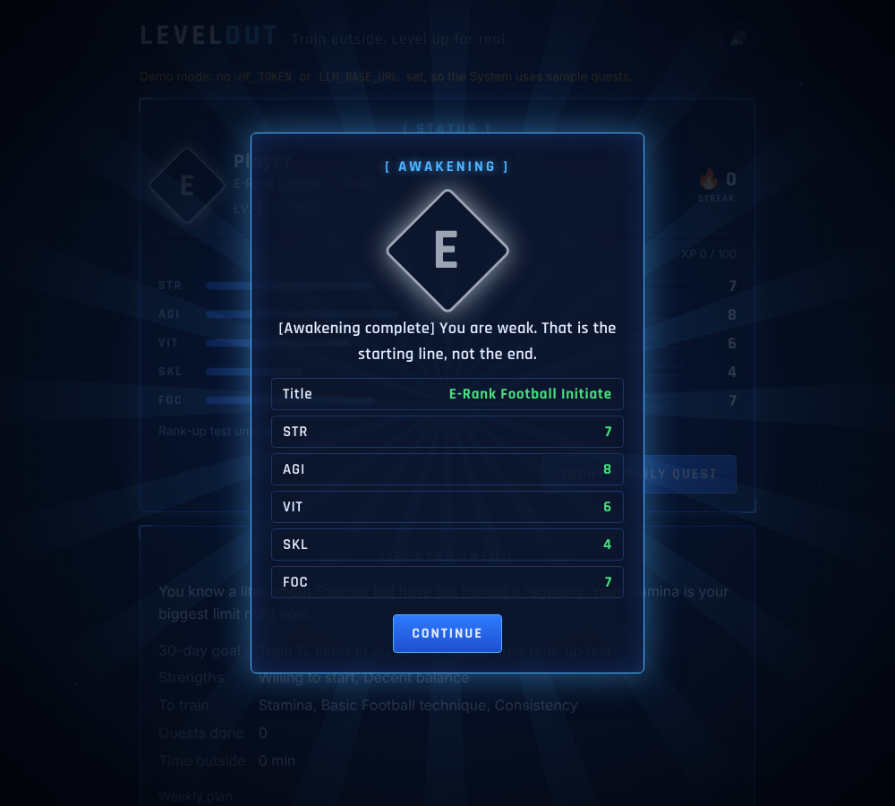
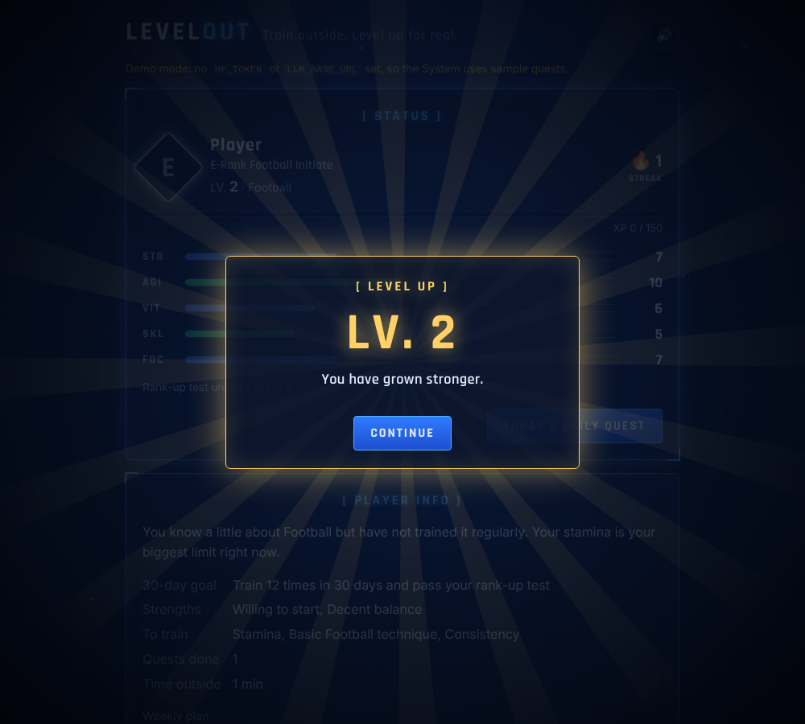
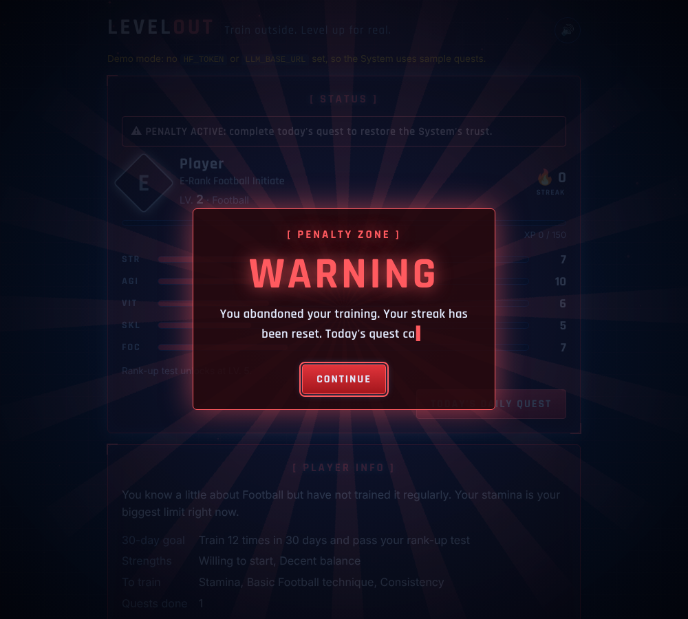

# ⚔️ LevelOut

**Train outside. Level up for real.**

LevelOut turns learning a real skill into a leveling anime. An open-weight AI model plays **the System**: it tests you, assigns you a rank, and gives you a **Daily Quest** of outdoor drills you can do **alone, with little or no equipment**. Complete it, report back, and you gain XP, stats and levels, while the System adapts tomorrow's quest to how you actually did.

Built for the **MLH × DEV Hacktoberfest Open-Source AI Challenge, Week 1: "Touch Grass"**.


## How it plays

1. **Accept the System.** *"You have met the conditions to become a Player."*
2. **Choose your path.** Pick any skill (football, cricket bowling, badminton footwork, skipping, a 5K, parkour, anything) and tick what you have: a wall, stairs, water bottles, a ball, a bench, or nothing at all.
3. **The trial.** The model writes 6 assessment questions for *your* skill, including an injury check.
4. **Awakening.** You get a rank (E to S), a title like *E-Rank Striker*, five stats (**STR, AGI, VIT, SKL, FOC**), strengths, weaknesses, a measurable 30-day goal, a rank-up test and a 7-day plan.
5. **Daily Quest.** A warm-up, 3–5 drills with clear instructions, targets, XP and easier/harder versions, a cool-down, a bonus challenge and a safety line. Every drill uses only what you have.
6. **Go outside.** Accept the quest and the timer starts. The screen tells you to pocket your phone. The quest survives closing the tab.
7. **Report.** Rate each drill *Easy / Just right / Hard / Hurt / Skipped*. You earn XP and stat points, level up, and keep your streak.
8. **The System adapts.** Easy drills get harder, hard ones get easier, and anything that **hurt is replaced** with a gentler drill for a different body part, with a "rest and see a doctor if it continues" warning.

### Feels like the anime

- **Full-screen System moments** for awakening, level up, rank up and the penalty zone, with a light burst, a slam-in window and stat changes listed.
- **System text types itself out** with soft beeps.
- **Stat bars fill with a glow**, and the stats you just trained flash green with "+1".
- **Rank colours:** E grey, D green, C blue, B purple, A orange, and S gold with a shimmer.
- **Live quest checklist** with a progress ring around the timer. Unticked drills are pre-marked "Skipped" in your report.
- **Penalty mode:** miss more than 2 days and the whole System turns red until you complete a quest.
- Floating particles, glowing buttons, and **sound + vibration** with a 🔊/🔇 toggle. It all respects "reduce motion" settings.

### Fair play: no XP for doing nothing

Progress lives on your device, so nothing is truly cheat-proof, but the System makes cheating slow and pointless:

- **Time lock:** reporting unlocks only after half your session length (minimum 5 minutes), with a countdown.
- **Only ticked drills earn XP.** In the report, unticked drills are locked to "Skipped". The bonus counts only if it was ticked during the quest.
- **No speed-ticking:** each tick must come at least a minute after the last one, or *"Too fast. The System saw that."*
- **Quest failed:** a report with nothing ticked gives 0 XP and no streak.
- **Movement verified (phones):** the motion sensor measures real movement during the quest. Moving earns **+10% XP**. It's a reward only, so a phone left on a bench is never punished.

### Game rules

| Mechanic | How it works |
|---|---|
| XP and levels | Each drill gives 10–50 XP, plus the bonus. Level *n* needs `100 + 50·(n−1)` XP. |
| Stats | Every completed drill gives +1 to its stat. Finishing every drill gives FOC +1. |
| Ranks | Your assessment sets your starting rank. A **rank-up test** unlocks at LV. 5 / 10 / 15 / 25 / 40, and you rank up only by passing it in real life. |
| Streak | Grows each training day. Rest days are allowed: it only breaks if you go more than 2 days without a quest. |
| Penalty quest | Break your streak and the next quest carries a penalty set. |

## Why it fits "Touch Grass"

The app's job is to get you *off* it. You spend a minute reading the quest, then the phone goes in your pocket and the actual training happens outside. Compared with a generic AI workout planner:

- **Skill-first, not just fitness.** It teaches you a sport or skill and measures progress with real tests.
- **Built around what you own.** Walls, stairs and water-bottle cones replace a gym.
- **It listens.** Every report changes the next quest, so it grows with you instead of repeating a fixed plan.
- **It's fun to come back to.** Ranks, stats and streaks borrow the hook that makes leveling anime addictive.

## Open-source AI at the core

**Which option it uses:** LevelOut **runs an open-weight model**, and it also supports **local or self-hosted inference** with one setting.

| | How |
|---|---|
| ✅ **Open-weight model** | The demo runs the System on **gpt-oss-120b** (open weights, Apache 2.0) served by [Groq](https://console.groq.com). Out of the box it can also use **Qwen2.5-72B-Instruct** via [Hugging Face Inference Providers](https://huggingface.co/docs/inference-providers). Either way it's called with the open-source `huggingface_hub` client, and you can swap models by changing `HF_MODEL`. |
| ✅ **Local / self-hosted inference (optional)** | Set `LLM_BASE_URL` to any OpenAI-compatible server, such as **Ollama**, **llama.cpp** or **vLLM**, and the exact same app runs on weights you host yourself. No code changes. |

**The open model is what makes the game work.** It writes the trial for your skill, judges your rank and stats, builds your weekly plan, designs every Daily Quest from your equipment, and rewrites the next quest from your report. Only the game maths (XP, levels, streaks) is plain code, on purpose, so the model can't inflate your progress.

All game state (XP, stats, history) is computed and stored **in your browser**. The server is stateless and keeps nothing.

### Run the System on your own machine (optional)

```bash
ollama pull qwen2.5:7b              # once
# in .env:
LLM_BASE_URL=http://localhost:11434/v1
HF_MODEL=qwen2.5:7b
```

## Run it

```bash
git clone https://github.com/SRG-Cy/levelout.git && cd levelout
python3 -m venv .venv && source .venv/bin/activate
pip install -r requirements.txt
cp .env.example .env      # paste your Hugging Face token into .env
python app.py             # open http://localhost:5000
```

**Free token:** [huggingface.co/settings/tokens](https://huggingface.co/settings/tokens) → *Create new token* → *Fine-grained* → tick **"Make calls to Inference Providers"**.

**Out of Hugging Face credits?** Use a free open-model host instead. With [Groq](https://console.groq.com/keys), put this in `.env`:

```
LLM_BASE_URL=https://api.groq.com/openai/v1
LLM_API_KEY=gsk_your_key_here
HF_MODEL=openai/gpt-oss-120b
```

**No token?** It runs in **demo mode** with sample trials and quests, including the "Hurt" adaptation, so you can play the whole loop.

**Deploy:** any Python host (Render, Railway, DigitalOcean App Platform). Set `HF_TOKEN` and use the start command `gunicorn app:app`.

**Tests:** `pip install pytest && python -m pytest -q`

## How it works

```
Browser (game engine)                     Flask (app.py)                  Open-weight model
 XP, levels, ranks, streaks   ── /api/assess ──▶  builds prompt  ── chat ──▶  writes the trial
 quest timer, debrief         ── /api/awaken ──▶  validates      ──────────▶  rates the Player
 localStorage                 ── /api/quest  ──▶  input          ──────────▶  designs + adapts quests
```

- `prompts.py`: the System's rules (outdoor, solo, only your equipment, safe progressions) and one prompt per step, each with a fixed JSON shape.
- `app.py`: three endpoints, input clamping, JSON extraction with one retry, and your token stays server-side.
- `static/app.js`: the game. Model output is always inserted as text, never HTML.
- `demo.py`: sample replies for demo mode.

## Screenshots

| Awakening | Level up | Penalty zone |
|---|---|---|
|  |  |  |

| Status window | Quest in progress (phone) | Choose your path |
|---|---|---|
|  |  |  |

## Safety

LevelOut is not medical advice. Every quest includes a warm-up, a cool-down and a safety line, the assessment always asks about injuries, and any drill you rate "Hurt" is replaced. Stop if something hurts, and see a professional if pain continues.

## Credits

Inspired by the "System" in leveling anime and manhwa. All names, text and visuals here are original.

## License

[MIT](LICENSE)
