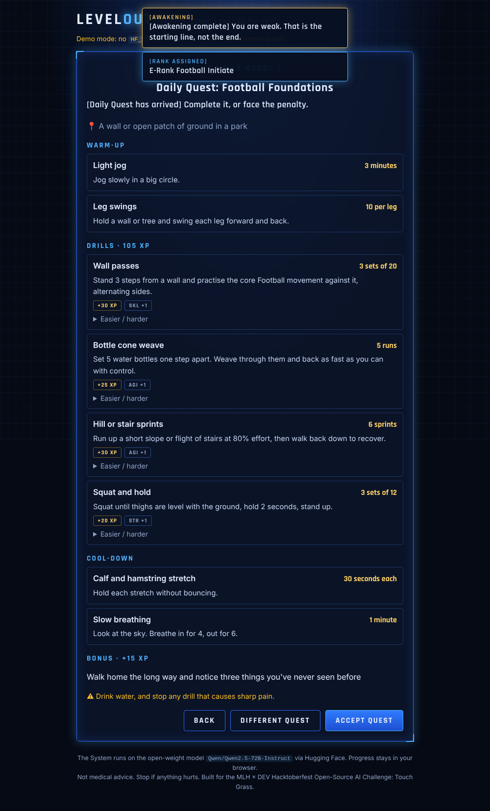
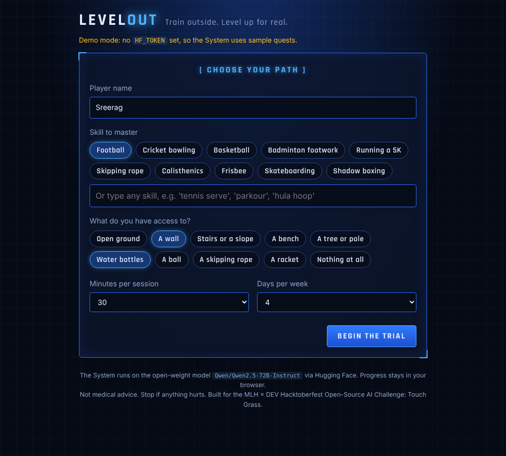
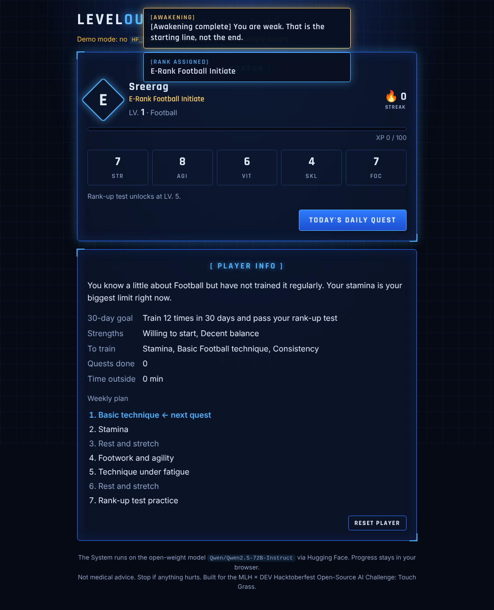
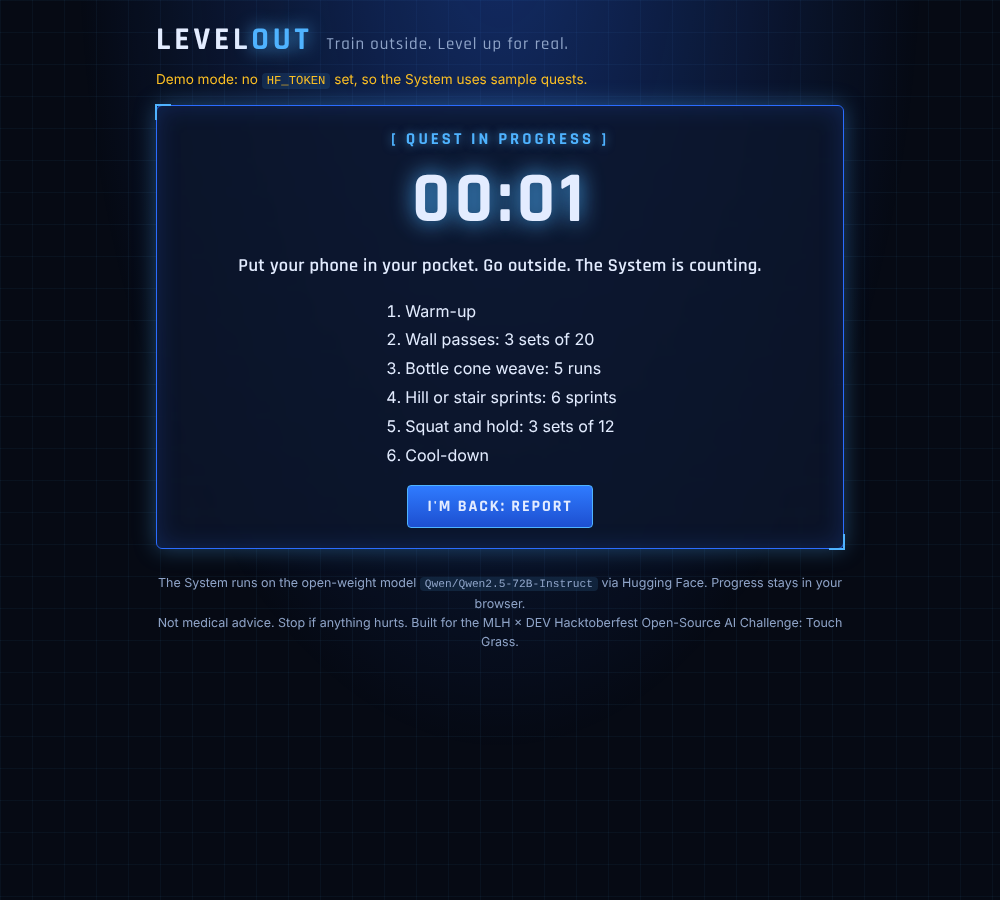

# ⚔️ LevelOut

**Train outside. Level up for real.**

LevelOut turns learning a real skill into a leveling anime. An open-weight AI model plays **the System**: it tests you, assigns you a rank, and gives you a **Daily Quest** of outdoor drills you can do **alone, with little or no equipment**. Complete it, report back, and you gain XP, stats and levels, while the System adapts tomorrow's quest to how you actually did.

Built for the **MLH × DEV Hacktoberfest Open-Source AI Challenge, Week 1: "Touch Grass"**.



## How it plays

1. **Accept the System.** *"You have met the conditions to become a Player."*
2. **Choose your path.** Pick any skill (football, cricket bowling, badminton footwork, skipping, a 5K, parkour, anything) and tick what you have: a wall, stairs, water bottles, a ball, a bench, or nothing at all.
3. **The trial.** The model writes 6 assessment questions for *your* skill, including an injury check.
4. **Awakening.** You get a rank (E to S), a title like *E-Rank Striker*, five stats (**STR, AGI, VIT, SKL, FOC**), strengths, weaknesses, a measurable 30-day goal, a rank-up test and a 7-day plan.
5. **Daily Quest.** A warm-up, 3–5 drills with clear instructions, targets, XP and easier/harder versions, a cool-down, a bonus challenge and a safety line. Every drill uses only what you have.
6. **Go outside.** Accept the quest and the timer starts. The screen tells you to pocket your phone. The quest survives closing the tab.
7. **Report.** Rate each drill *Easy / Just right / Hard / Hurt / Skipped*. You earn XP and stat points, level up, and keep your streak.
8. **The System adapts.** Easy drills get harder, hard ones get easier, and anything that **hurt is replaced** with a gentler drill for a different body part, with a "rest and see a doctor if it continues" warning.

### Game rules

| Mechanic | How it works |
|---|---|
| XP and levels | Each drill gives 10–50 XP, plus the bonus. Level *n* needs `100 + 50·(n−1)` XP. |
| Stats | Every completed drill gives +1 to its stat. Finishing every drill gives FOC +1. |
| Ranks | Your assessment sets your starting rank. A **rank-up test** unlocks at LV. 5 / 10 / 15 / 25 / 40, and you rank up only by passing it in real life. |
| Streak | Grows each training day. Rest days are allowed: it only breaks if you go more than 2 days without a quest. |
| Penalty quest | Break your streak and the next quest carries a penalty set. |

## Why it fits "Touch Grass"

The app's job is to get you *off* it. You spend a minute reading the quest, then the phone goes in your pocket and the actual training happens outside. Compared with a generic AI workout planner:

- **Skill-first, not just fitness.** It teaches you a sport or skill and measures progress with real tests.
- **Built around what you own.** Walls, stairs and water-bottle cones replace a gym.
- **It listens.** Every report changes the next quest, so it grows with you instead of repeating a fixed plan.
- **It's fun to come back to.** Ranks, stats and streaks borrow the hook that makes leveling anime addictive.

## Open-source AI at the core

The System is an **open-weight model** (default `Qwen/Qwen2.5-72B-Instruct`) called through [Hugging Face Inference Providers](https://huggingface.co/docs/inference-providers). Nothing runs on your computer. Swap in Llama, Gemma, Mistral or any other open model by changing `HF_MODEL`, or point it at your own self-hosted copy.

All game state (XP, stats, history) is computed and stored **in your browser**. The server is stateless and keeps nothing.

## Run it

```bash
cd levelout
python3 -m venv .venv && source .venv/bin/activate
pip install -r requirements.txt
cp .env.example .env      # paste your Hugging Face token into .env
python app.py             # open http://localhost:5000
```

**Free token:** [huggingface.co/settings/tokens](https://huggingface.co/settings/tokens) → *Create new token* → *Fine-grained* → tick **"Make calls to Inference Providers"**.

**No token?** It runs in **demo mode** with sample trials and quests, including the "Hurt" adaptation, so you can play the whole loop.

**Deploy:** any Python host (Render, Railway, DigitalOcean App Platform). Set `HF_TOKEN` and use the start command `gunicorn app:app`.

**Tests:** `pip install pytest && python -m pytest -q`

## How it works

```
Browser (game engine)                     Flask (app.py)                  Open-weight model
 XP, levels, ranks, streaks   ── /api/assess ──▶  builds prompt  ── chat ──▶  writes the trial
 quest timer, debrief         ── /api/awaken ──▶  validates      ──────────▶  rates the Player
 localStorage                 ── /api/quest  ──▶  input          ──────────▶  designs + adapts quests
```

- `prompts.py`: the System's rules (outdoor, solo, only your equipment, safe progressions) and one prompt per step, each with a fixed JSON shape.
- `app.py`: three endpoints, input clamping, JSON extraction with one retry, and your token stays server-side.
- `static/app.js`: the game. Model output is always inserted as text, never HTML.
- `demo.py`: sample replies for demo mode.

## Screenshots

| Choose your path | Status window | Quest in progress |
|---|---|---|
|  |  |  |

## Safety

LevelOut is not medical advice. Every quest includes a warm-up, a cool-down and a safety line, the assessment always asks about injuries, and any drill you rate "Hurt" is replaced. Stop if something hurts, and see a professional if pain continues.

## Credits

Inspired by the "System" in leveling anime and manhwa. All names, text and visuals here are original.

## License

[MIT](../LICENSE)
